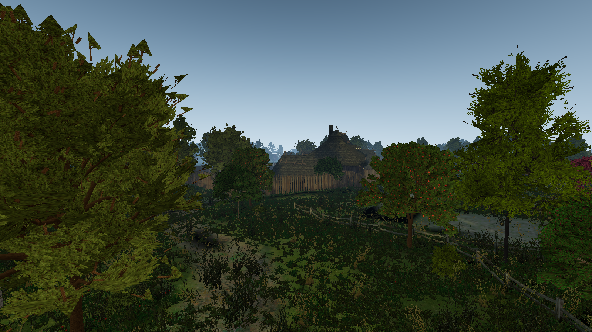
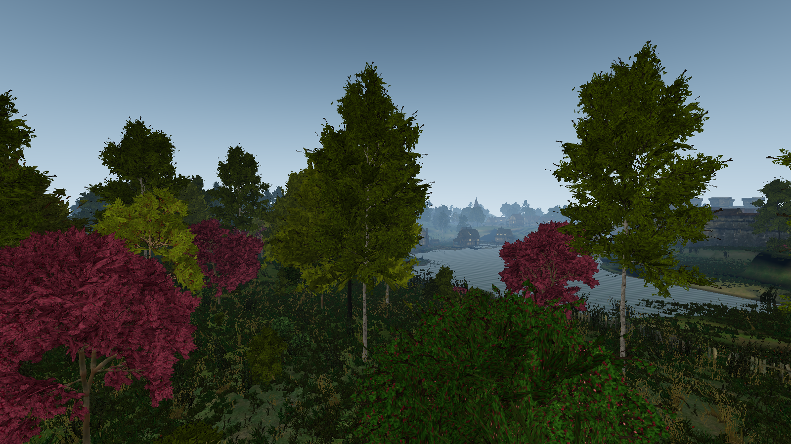
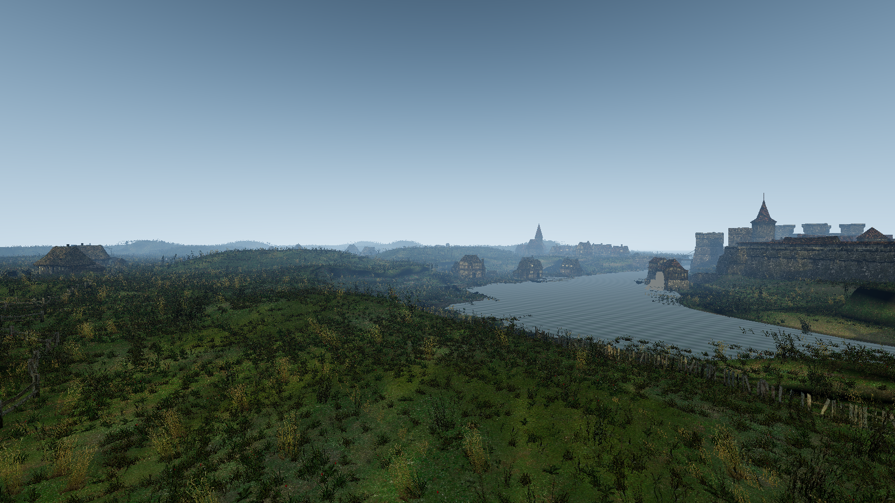
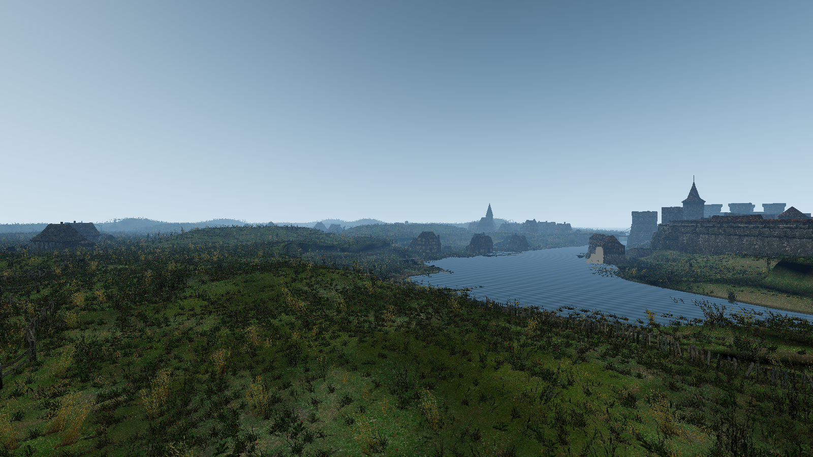
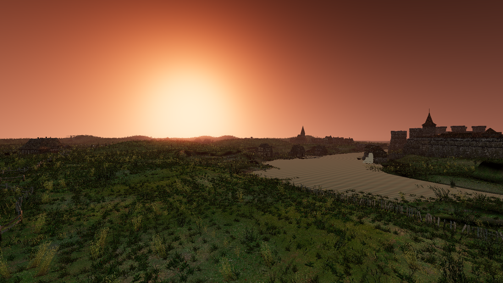
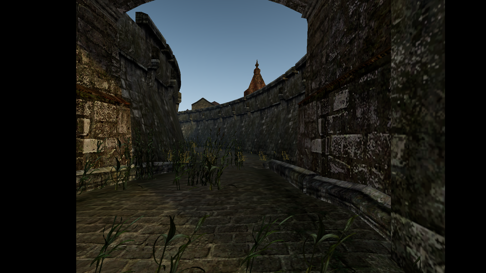
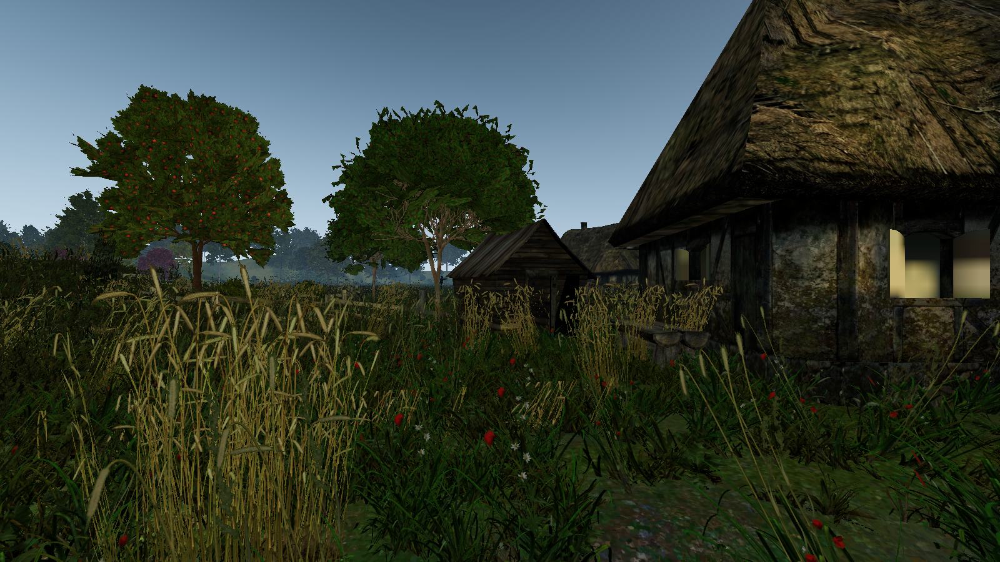

# Witcher 1 asset pipeline and fidelity report

Status: **Vizima Outskirts (Act 1) loads in Godot 4.6 and renders with the original
geometry, textures and baked lightmaps.** Everything below is measured from the
retail Enhanced Edition install, not from loose data or third-party rips.



---

## 1. What is actually in the install

`Data\main.key` indexes **34,109 resources across 19 BIFF archives** (plus the
`Data\modules\*.mod` files, which are ERF modules):

| Type | Count | Meaning |
| ---- | ----: | ------- |
| 2013 | 59 | area `.set` (grass, tiles, terrain rules) |
| 2070 | 3,216 | `.mdb` models (area geometry, props, characters) |
| 2033 | 8,827 | `.dds` textures |
| 2042 | 52 | `.utd` door templates |
| 2044 | 1,174 | `.utm` placeable templates |
| 2079 | 300 | SpeedTree `.spt` descriptors |
| 2023 | — | `.git` area instances (inside modules) |
| 2016 | **0** | `.are` area settings — **none ship at all** |

All of these are plain little-endian binary and are parsed by `tools/witcher1` with
no binary dependency on the game.

## 2. What we can extract, and do

### 2.1 Area geometry — works

`gl09.mdb` is 55.5 MB and holds **4,953 nodes**: 810 trimeshes, 186 texture-paint
(terrain) nodes, 2,813 SpeedTree nodes, 1,143 plain transform nodes, 1 AABB.

Exported to `assets/witcher1/vizima_outskirts.glb`:

* 770 meshes, **327,683 triangles**, 25.3 MB
* 228 materials, 8 baked-lightmap sets
* only LOD0 (226 higher-LOD nodes skipped), and collision-only meshes skipped

Two UV sets are preserved. They are **not** interchangeable:

* **UV0 → lightmap atlas** (UV0 is in 0..1 space of the lightmap page)
* **UV1 → Godot UV2 → tiling diffuse**

Texture-paint terrain nodes carry up to 8 layer textures with per-vertex weights.
The top four layers are packed into `COLOR_0` (measured mean truncation residual:
**0.089**), which the shader blends.

### 2.2 Baked lightmaps — works

Lightmap sets are named per surface group (`L09_terA00`, `L09_mury02`, `l09_drzwi`,
…). Each set ships **four baked variants**, `!r`, `!p`, `!w`, `!n` — morning, noon,
evening, night. 15 sets × 4 = 60 PNGs in `assets/witcher1/lightmaps/` with an
`index.json` mapping set → per-time-of-day file.

`W1Area.set_time_of_day("n")` re-points every material at the night bake. This is
the original game's day/night system, not an invention.

### 2.3 Objects and spawnpoints — works

`l09.git` (1.86 MB) inside `outskirts_1.mod` contains 430 action points, **75 doors,
605 placeables, 485 spawnpoints**, 85 sounds, 46 triggers, 274 waypoints.

`assets/witcher1/vizima_outskirts_props.glb` + `props.json` contain 632 placed
instances (753 nodes, 231 meshes, 3.9 MB) plus every spawnpoint with position and
orientation, and the doors.

### 2.4 Grass / terrain rules — parsed, not yet used

`gl09.set` (type 2013) is a plain INI that the engine reads:

```ini
[GENERAL]
VegetationMap=l09_trawa_      ; density mask texture
[GRASS]
Texture=trawa_set07
Density=2.000
Model00MinScale=0.600
```

There are `[GRASS]`…`[GRASS6]` blocks, `[TERRAIN TYPES]` and 75 `[TILE0DOOR*]`
entries. So the *placement* rules for grass are available; the grass *meshes* are
SpeedTree models (see below).

### 2.4 Grass — works

`gl09.set` is a plain INI that the engine reads:

```ini
[GENERAL]
VegetationMap=l09_trawa_
[GRASS]
Texture=trawa_set07
Density=2.000
DiffuseRed=0.588
Model00MinScale=0.600
Model00MaxScale=0.800
```

The `Texture=` key does **not** name a texture: `trawa_set07` is an MDB model with
`grass_geom00..03` meshes textured `trw_set3`. So the original grass geometry is
shipped and extractable. `export_grass.py` merges each type into one patch mesh,
then scatters 400,000 patches over the terrain, placed where the terrain's own
texture-paint layers say `trn_trawa_*` outweighs rock, mud and paving. The `.set`
supplies the per-type scale range and the 0.588 diffuse tint.

`l09_trawa_` itself (type 2082, 512 × 2015 × 7 channels) turned out to be a baked
lightmap page, not the density mask its `VegetationMap=` name implies, so placement
is derived from the terrain layers instead.

### 2.5 Day/night — works

`addons/sky_3d` drives the sky, sun and moon. `W1Area` maps the sky's hour onto the
four baked lightmap sets (morning 05–10, noon 10–16, evening 16–20:30, night
otherwise) and retints the water, so the sky and the baked lighting stay in step
while the cycle runs.

## 3. What we cannot extract

### 3.1 Vegetation — the tree meshes are gone, but the impostor art is not

All 300 type-2079 resources — `l09_drzewo_01..20` (trees), `l09_krzak_01..15`
(bushes) — are 5–7.6 KB **SpeedTree IDV descriptors** (`__IdvSpt_02_`,
`BezierSpline`, procedural generators + branch/leaf parameters). There is **no
vertex data**. The 2,813 SpeedTree nodes in `gl09` carry only position/rotation.

Consequence: the baked lightmaps contain the shadows of trees that are not there.

However, `l09_drzewa_cm` (textures01.bif, 2048 × 2048) is the **tree impostor
atlas**: pre-rendered billboards of every tree species in trunk and full-canopy
form, plus leaf-cluster and bark detail cells. `l09_krzaki_cm` is the same for
bushes. The SpeedTree nodes even carry an `imposterGroup`, so species mapping is
recoverable.

The tree *bodies* are substituted from a third-party pack
(`assets/forest/forest_assets.glb`, CC-BY, 34 assets in 130k triangles — see its
`CREDITS.md`), placed at the original 2,813 SpeedTree transforms by
`tools/witcher1/export_trees.py`. The ground already carries the original tree
shadows baked into its lightmaps, so reusing the exact transforms keeps those shadows
lined up with the substitute trees.

Each tree is its own `MeshInstance3D` pair (bark + foliage cards) rather than a
MultiMesh, for two reasons: the glTF importer's automatic mesh LODs
(`meshes/generate_lods`, on by default) only apply per `MeshInstance3D`, and a
MultiMesh has one bounding box, so its instances would all share a single LOD and a
single frustum test. 2,813 trees become 5,604 mesh instances, culled per object out
to 400 m. Measured cost at 1600x900: **223 fps with the forest, 345 fps without**, so
no streaming is needed — unlike the grass, where there are 400,000 of them.

Scales: `TREE_SCALE = 0.8` and `BUSH_SCALE = 0.3`. The pack's shrubs are 5–15 m wide,
and with 1,444 bush placements at full size they merge into a hedge and wall off the
whole map.

Species mapping is curated, not extracted: the original models are opaque
(`l09_drzewo_01..20`, `l09_krzak_01..15`), so the map keeps the forest
deciduous-dominant with a few conifers and gives the most frequent species the most
generic trees. The impostor atlas would be the way to map species exactly.

Two things had to be fixed to use the pack at all:

* its materials are Sketchfab specular/glossiness with no metallic/roughness
  fallback, which Godot cannot read — `tools/witcher1/fix_tree_pack.py` rewrites them
  and switches the foliage cards from alpha blend to alpha mask
* the area is unshaded (light baked into the lightmaps), so a PBR tree lit only by
  Sky3D renders almost black next to the ground. `shaders/w1_foliage.gdshader` gives
  them the same treatment as the ground: a constant ambient term plus a fixed wrapped
  Lambert term, no real-time lighting

`tools/w1_treecheck.tscn` drops a few pack assets into the real area for a look.

### 3.2 Area lighting / fog / water parameters

There is **no `.are` resource anywhere** in the install or in the module. The
engine's per-area sun direction, ambient, fog and water settings are not shipped as
data we can read, so:

* sky, fog and water colours in the remake are authored, not extracted
* the directional sun in the bake is implicit in the lightmaps

### 3.3 Walkmesh / navigation

`gl09` type 2013 is the `.set`, and the walkable surface is a separate WOK-style
resource we have not decoded. Collision can be regenerated from the visual mesh
instead; it will not match the original slope limits exactly.

### 3.4 Skybox

The `skaybox_l09` placeable model exists and has ~11 nested shells (up to 2,956 ×
5,110 × 4,840 units) but **every texture slot is empty**: the engine binds
`clouds-2`, `clouds_deszcz`, `haze`, `stars`, `_sky_sun`, `_sky_moon`, `sun_glow`
at runtime. The individual cloud tiles do exist (`clouds1..9`, `stars`, 512×512
each), but the shell→texture assignment does not. The remake currently uses a
gradient sky.

### 3.5 Doors

Door models are 12-triangle panels whose mesh has **no texture** in the MDB, and the
`dr_09` door template carries no texture either. Only placeables that happen to
name a diffuse in texture slot 0 are textured. Doors currently render as a neutral
lit grey; the exact original binding is unknown.

## 4. The pipeline

```
Data\main.key ──► w1index.py ──► resource index
                      │
      .mdb ──► mdb.py/mdbtree.py ──► nodes, transforms, mesh arrays
      .git ──► gff.py ─────────────► placeables, doors, spawnpoints
      .set ────────────────────────► grass / terrain rules
                      │
                      ▼
     w1mesh.describe() ──► arrays + material name contract
                      │
                      ▼
     w1gltf.Glb ──► *.glb (geometry only) + loose PNG textures/lightmaps
                      │
                      ▼
     Godot import ──► W1Area script ──► shader materials, TOD, LOD/culling
```

Commands (from the repo root, `python tools/witcher1/export_area.py` etc.):

```powershell
python tools\witcher1\export_area.py      # gl09 -> vizima_outskirts.glb
python tools\witcher1\export_props.py     # l09 git -> vizima_outskirts_props.glb + props.json
python tools\witcher1\export_grass.py     # gl09.set -> grass patches + placement
```

Environment overrides: `W1_GAME`, `W1_DATA`, `W1_CACHE` (defaults to the GOG install,
`.w1cache` for extracted resources).

### 4.1 Material name contract

Textures and lightmaps are deliberately **not embedded in the glTF**, so import
settings, VRAM compression and day/night swapping stay in our control. Instead the
material *name* carries the binding:

| Name | Meaning |
| ---- | ------- |
| `W1S\|<diffuse>\|<lightmapSet>\|<flags>` | static surface |
| `W1T\|<d0>,<d1>,<d2>,<d3>\|<lightmapSet>\|<flags>` | texture-paint terrain, `COLOR_0` = layer weights |
| `W1X\|<shaderName>\|<lightmapSet>\|<flags>` | engine-shader surface (`proc_water`) |
| `W1G\|<diffuse>\|<grassType>\|<flags>` | grass patch |

`flags` bit 0 = alpha scissor.

### 4.2 Lighting model

The original multiplies albedo and lightmap in gamma space and composites unshaded.
Since every texture is sampled with `source_color` (so it arrives linear), that
multiply is exactly `ALBEDO = albedo * lightmap` — no gamma juggling needed. An
earlier `pow(..., 1/2.2)` applied an extra encode and was the cause of the washed-out
first renders.

Surfaces with no diffuse but a lightmap (building interiors seen through windows)
use the lightmap as their albedo, which is what the engine does with the missing
texture.

### 4.3 Runtime

`scripts/w1_area.gd` (`class_name W1Area`):

* instantiates area + props GLBs as **internal children**, so the built geometry shows
  up in the editor viewport but is never written into the saved scene
* rebuilds every shader material from the name contract
* `set_time_of_day(tag)` swaps all lightmaps and retints the water
* follows `Sky3D.current_time` and swaps the lightmap set as the sun moves
* `set_ambient(v)` lifts the lightmap term
* hides map-edge cover planes (`Oslona*`)
* builds static trimesh collision at runtime only (766 area + 753 prop shapes)
* reports anything it could not resolve (`unresolved`)

Both `W1Area` and `W1Grass` are `@tool` scripts, so the scene previews in the editor
instead of appearing empty until you press Play.

`scripts/w1_trees.gd` (`class_name W1Trees`) builds one `MeshInstance3D` per tree part
from `trees.bin` (2,813 placements, 6 floats each: position, yaw, scale, asset) and
gives each surface `shaders/w1_foliage.gdshader`.

`scripts/w1_grass.gd` (`class_name W1Grass`) **streams** the grass around the camera.The exporter writes one flat array of transforms per grass type; at load the node
buckets them into 64 m tiles and then only builds the tiles whose centre is inside
`spawn_radius` (200 m) of the active camera, freeing them once they fall outside
`keep_radius` (280 m). The set is re-evaluated every 0.2 s, so the circle of grass
moves with the player. Out of 400,000 exported patches about 50,000 are instanced at
any moment.

Streaming also sidesteps a culling trap: one MultiMesh covering the whole map has a
single huge bounding box, so Godot's distance culling would hide *all* the grass as
soon as the camera left the middle of the map.

`scenes/areas/vizima_outskirts.tscn` is the area on its own with a fixed camera (used
by the preview harness). `scenes/Vizima_outskirts_02.tscn` is the playable version:
the same area plus Sky3D and the player, spawned on the bridge from the GIT's
`Mikul_spdp` spawnpoint. `W1Area` builds static trimesh collision for the area and
the props so the character can walk the map.

`scenes/Vizima_outskirts_03.tscn` is a separate Terrain3D comparison. It hides the
original ground, draws a 1 m heightfield with the ground projected from above, and
imports the 400,000 grass patches into Terrain3D's foliage instancer. Scene 02 is
unchanged and remains the reference. See `docs/terrain3d-test.md`.

`tools/w1_preview.gd` is a dev harness that renders fixed views, every spawnpoint,
a time-of-day sweep, a Sky3D hour sweep and an ambient sweep into `user://shots`.
`tools/w1_playtest.gd` loads the playable scene, lets the character settle and
reports the resulting position, the active camera and a screenshot — it is how you
check that collision and the camera rig still work without opening the editor.

### 4.4 Working on the environment in the editor

`W1Area` is a `@tool` script, so opening `scenes/Vizima_outskirts_02.tscn` builds the
whole map in the editor viewport. The generated geometry is added as ordinary
children named `Area` and `Props`, which means:

* they appear in the Scene dock and every mesh can be selected to read its name and
  transform (the names are the original MDB node names, e.g. `pre_zajazd_03`,
  `inn_gate1`, `p240.ob_boatsail02.2`)
* they carry **no owner**, so they are never written into the saved `.tscn` — the area
  is regenerated from the GLB on every load
* consequently, edits made directly to those nodes are lost on the next reload

Put your own work under the `Custom` node instead; it is an ordinary empty `Node3D`
in the scene and its contents are saved normally.

`W1Area` also exposes `hide_terrain`. Setting it hides the 186 W1T ground meshes
while keeping buildings, props, water and the baked surfaces. Scene 03 uses this
to put a Terrain3D ground under the original village. Do not set `region_size` on
the Terrain3D node in that scene; Terrain3D takes it from the region data.

Editor camera: the scene lives around **X 1136…2324, Z −2510…−1185** (1 unit = 1 m),
so a fresh editor camera looking at the origin sees empty sky. Select `Area` in the
Scene dock and press **F** to frame the whole map, or select `Player` and press **F**
to drop down onto the bridge.

Reference coordinates of the GIT spawnpoints (handy for placing things):

| Spawnpoint | Position |
| --- | --- |
| `Mikul_spdp` (start, bridge) | 1837, 0, −1603 |
| `haren_house_spdp` (inn) | 1716, −6, −1638 |
| `final_fight` | 1535, 0, −1581 |
| `abigail_out` | 1663, 0, −1485 |
| `barg_milit01` | 1612, 0, −1730 |

The full list of 485 spawnpoints, plus every prop and door transform, is in
`assets/witcher1/props.json`.

Run:

```powershell
# playable
& "D:\Godot_v4.6.1-stable_win64.exe\Godot_v4.6.1-stable_win64_console.exe" `
  --path "D:\Godot Projekty\Witcher_1_fan_remake" `
  "res://scenes/Vizima_outskirts_02.tscn"

# screenshots
& "D:\Godot_v4.6.1-stable_win64.exe\Godot_v4.6.1-stable_win64_console.exe" `
  --path "D:\Godot Projekty\Witcher_1_fan_remake" --resolution 1600x900 `
  "res://tools/w1_preview.tscn"
```

## 5. Current fidelity state

Working and faithful:

* architecture, terrain, roads, palisades, thatch, cobbles — original meshes
* baked sun/shadow/AO — original lightmaps, four times of day
* window glow and interior depth — original lightmap-as-albedo
* object placement — original GIT transforms
* grass — original `trawa_set*` clump meshes, original tints, placed from the
  terrain's own paint layers
* sky, sun and moon — Sky3D cycle, kept in step with the baked lightmap sets
* river surface — approximated `proc_water`

| Noon | Night |
| --- | --- |
|  |  |

| Sky3D at 13:00 | Sky3D at 18:30 |
| --- | --- |
|  |  |

| Gate tunnel (Mikul spawnpoint) | Cottage (final fight spawnpoint) |
| --- | --- |
|  |  |

Known gaps, in order of visual impact:

1. **No trees or bushes** — 2,813 instances are missing while their shadows remain
   baked into the lightmaps. The impostor atlas (`l09_drzewa_cm`) makes this
   solvable: billboard the 20 species from the game's own renders at the original
   transforms.
2. **Doors are untextured** — the door models carry no texture and the `dr_09`
   template carries none either.
3. Water is an approximation; no reflections or refraction
4. Grass reads as scattered clumps rather than a lawn in the near field; the patch
   meshes are metres wide and the density is a budget, not the original placement
5. Distant map edge is visible from high vantage points (the original hides it with
   black cover planes and fog)
